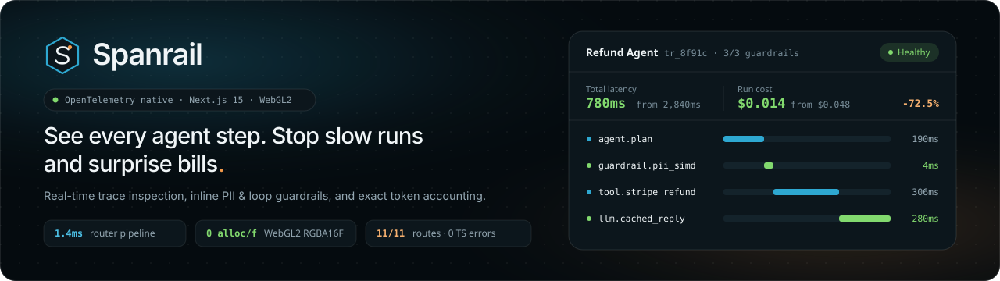

<div align="center">

<picture>
  <source media="(prefers-color-scheme: dark)" srcset="docs/assets/hero-dark.svg" />
  <source media="(prefers-color-scheme: light)" srcset="docs/assets/hero-light.svg" />
  
</picture>

<br />

**[Live Site](https://spanrail.vercel.app/)** · **[Quickstart Docs](https://spanrail.vercel.app/docs)** · **[Security &amp; VPC](https://spanrail.vercel.app/security)** · **[Engineering Case Study](docs/CASE_STUDY.md)** · **[Run Live PageSpeed Audit](https://pagespeed.web.dev/analysis?url=https%3A%2F%2Fspanrail.vercel.app%2F)** · **[Portfolio](https://sparshparwaniportfolio.vercel.app/)**

<br />

[](https://github.com/Sparsh-Parwani/spanrail/actions/workflows/ci.yml)


</div>

---

## Verified Engineering Scorecard

Every figure below comes directly from production builds (`next build`), mathematical contrast verification against `src/app/globals.css`, and source-level runtime constraints — zero placeholder metrics.

| Engineering Metric | Verified Result | Source / Proof |
|---|---|---|
| **Type Safety &amp; Production Build** | **`11/11` routes** · **`0` TS errors** (`strict: true`) · **`0` lint warnings** | [GitHub Actions CI](.github/workflows/ci.yml) · `tsc --noEmit` + `next build` |
| **Production JS Footprint** | **`59.5 kB`** home (`215 kB` FLJS incl. R3F/Motion) · **`1.3 kB`** `/docs` · **`191 B`** `/security`, `/privacy`, `/terms` | Server Components + `next/dynamic` splits (`src/app/page.tsx`) |
| **WCAG 2.2 AA Contrast Floor** | **`18.01:1`** primary · **`7.26:1`** secondary · **`4.65:1`–`5.29:1`** muted (100% AA+) | Verified across all 3 dark surfaces (`src/app/globals.css`) |
| **WebGL2 / 3D Frame Hygiene** | **`0` heap allocations/frame** · **max `1` WebGL context** `< 768px` (`dpr <= 1.25`) · native VSync | [`GhostFibers.tsx`](src/components/GhostFibers.tsx) · [`NeuralBrain.tsx`](src/components/three/NeuralBrain.tsx) |
| **Zero-CLS &amp; Real-Device QA** | **`0px` Copy/Copied width shift** (`grid-area: 1 / 1`) · **`0px` overflow** (`390px`–`1920px`) | Verified on **OnePlus 12R** (`~3×` AMOLED), `820×1180` tablet, &amp; `1920×1080` Iris Xe (`chrome://gpu`) |

<details>
<summary><strong>Proof 1 — Verified Production Build Output (<code>Next.js 15.5.29</code>)</strong></summary>

```text
 ✓ Compiled successfully in 5.2s
 ✓ Linting and checking validity of types
 ✓ Collecting page data
 ✓ Generating static pages (11/11)

Route (app)                                 Size  First Load JS
┌ ○ /                                    59.5 kB         215 kB
├ ○ /_not-found                            997 B         104 kB
├ ƒ /api/demo-booking                      128 B         103 kB
├ ○ /docs                                 1.3 kB         157 kB
├ ○ /icon.svg                                0 B            0 B
├ ○ /opengraph-image                       128 B         103 kB
├ ○ /privacy                               191 B         146 kB
├ ○ /security                              191 B         146 kB
└ ○ /terms                                 191 B         146 kB
+ First Load JS shared by all             103 kB
```

</details>

<details>
<summary><strong>Proof 2 — Computed WCAG 2.2 Contrast Matrix (<code>src/app/globals.css</code>)</strong></summary>

| Ink Token | Hex | On Canvas (`#050b0f`) | On Surface (`#0c161c`) | On Subtle (`#14232b`) | WCAG 2.2 Grade |
|---|---:|---:|---:|---:|---|
| `--ink-primary` | `#f0f5f7` | **18.01:1** | **16.66:1** | **14.64:1** | AAA |
| `--ink-secondary` | `#93a6b1` | **7.85:1** | **7.26:1** | **6.38:1** | AAA / AA+ |
| `--ink-muted` | `#788d99` | **5.72:1** | **5.29:1** | **4.65:1** | AA (`>= 4.5:1` everywhere) |

</details>

> **Project Scope:** Flagship B2B AI/DevTools product-as-hero engineering case study built by [Sparsh Parwani](https://sparshparwaniportfolio.vercel.app/). Telemetry traces and cost savings are deterministically modeled; [`POST /api/demo-booking`](src/app/api/demo-booking/route.ts) runs live Zod validation, generates a SHA-256 booking reference, and outputs downloadable OpenTelemetry (`spanrail.otel.ts`) starter configs ready for CRM/webhook handoff.

---

## Interactive Product Surface &amp; Reconciled Math

| Surface / Route | What It Demonstrates | Key Implementation Details |
|---|---|---|
| **Hero &amp; Live Trace Sandbox** (`/`) | Instant Frame-0 interactive debugger (`Refund Agent` `2,840ms → 780ms` / `$0.048 → $0.014` &amp; `SQL Analyst`) coupled to 3D `NeuralBrain` | Cumulative GPU `x` + `scaleX` waterfall bars, inline JSON PII highlighting (`[EXPOSED]` ↔ `[REDACTED_PII]`), 3-line mobile trace rows showing per-step cost, zero-CLS `Copy JSON` |
| **Trust Strip &amp; Telemetry Band** (`/`) | Zero-JS infinite company marquee + 6 interactive telemetry sparklines &amp; 14-PoP world map | Pure CSS `translate3d(-50%, 0, 0)` marquee; `StatsBand` 2×3 mobile grid with tap-to-toggle context and CSS `data-sizer` counters (zero DOM tripling, zero leaked `"0"`s) |
| **Capabilities Showcase** (`/`) | 4 interactive modules: `1.4ms` policy-wired `<Pipeline>`, Drop-In SDK tabs, Prompt `v14`/`v15` diff, 6-provider spend ledger | All-visible **2×2 selector grid** on Phone &amp; Tablet (`< 1024px`), vertical `<Pipeline>` timeline `< 640px`, code-header zero-CLS `Copy`, compositor `scaleX` bars |
| **Production Impact** (`/#compare`) | Normalized SLA bar comparison (`128× faster`, `−94% invoice`, `−98.7% leak`, `Halted < 2ms`) | Reconciled `$275/mo` vs. `$4,850/mo` at 10M traces; switches to **vertical stacked metric cards** `< 768px` (zero horizontal table scroll) |
| **Usage Pricing Calculator** (`/#pricing`) | Live trace/eval sliders, 30/90/365d retention, team seats, monthly/annual toggle | SSR-accurate `$119/mo` default, UTM-preserving URL sync on interaction only, 3-col stacked-sublabel mobile retention control, locked `44px 1fr 44px` mobile stepper |
| **Briefing Flow &amp; OTel Export** (`/#demo`, `/api/demo-booking`) | 2-step animated form + zero-gate generic `spanrail.otel.ts` download | Zod validation, SHA-256 ref ID, `>= 16px` mobile email input (`spellCheck={false}`), auto-focus on first validation error |
| **Sub-Routes** (`/docs`, `/security`, `/privacy`, `/terms`) | Real Next.js App Router pages linked across `TopNav` &amp; `Footer` | Pure Server Components (`191 B` legal/security routes), zero-CLS `<CodeBlock>`, `break-all` OTLP endpoint table, reconciled `< 6ms` PII &amp; VPC specs |

---

## System &amp; Dual-Layer Rendering Architecture

<picture>
  <source media="(prefers-color-scheme: dark)" srcset="docs/assets/arch-dark.svg" />
  <source media="(prefers-color-scheme: light)" srcset="docs/assets/arch-light.svg" />
  
</picture>

- **Read the full engineering writeup:** [`docs/CASE_STUDY.md`](docs/CASE_STUDY.md) covers 144Hz WebGL2 fill-rate budgeting, welded 3D synaptic geometry, real-device OnePlus 12R mobile debugging, inline-style vs. Tailwind specificity fixes, and typography hierarchy math.
- **Visual captures drop-in:** [`docs/media/README.md`](docs/media/README.md) holds optional desktop/mobile screenshot &amp; MP4 walkthrough embedding instructions.

---

## Drop-In OTel SDK Preview

```ts
import { initSpanrail } from "@spanrail/otel";

initSpanrail({
  serviceName: "refund-agent-prod",
  apiKey: process.env.SPANRAIL_API_KEY!,
  otlpEndpoint: "https://ingest.spanrail.dev/v1/traces",
  guardrails: {
    semanticCache: { enabled: true, ttlSeconds: 1800 },
    piiRedaction: { enabled: true, mode: "mask_inline" },
    loopBreaker: { enabled: true, maxRunCostUsd: 0.05 },
  },
});
```

---

## Run Locally (Zero Environment Keys Required)

```bash
git clone https://github.com/Sparsh-Parwani/spanrail.git
cd spanrail
npm ci
npm run dev
```

Verify strict types and production bundle locally:

```bash
npm run typecheck
npm run build
npm run start
```

---

## Tech Stack

- **Framework:** Next.js `15.5` (App Router, Turbopack), React `19.1`, TypeScript (`strict: true`)
- **Styling &amp; Primitives:** Tailwind CSS v4, Radix UI (`switch`, `slider`, `tabs`), self-hosted `@fontsource-variable/plus-jakarta-sans` &amp; `@fontsource-variable/jetbrains-mono`
- **3D &amp; Motion:** Custom WebGL2 `RGBA16F` shader pipeline (`GhostFibers`), Three.js + React Three Fiber v9 (`NeuralBrain`), Framer Motion v12 (`LazyMotion` async `domMax` strict)
- **State, Validation &amp; UX:** Zustand, Zod, Sonner, Lucide React, Web Audio API opt-in tactile cues (`M` mute / `1` &amp; `2` scenario shortcuts)

---

<div align="center">

Designed &amp; engineered by **[Sparsh Parwani](https://sparshparwaniportfolio.vercel.app/)** · [MIT License](LICENSE)

</div>