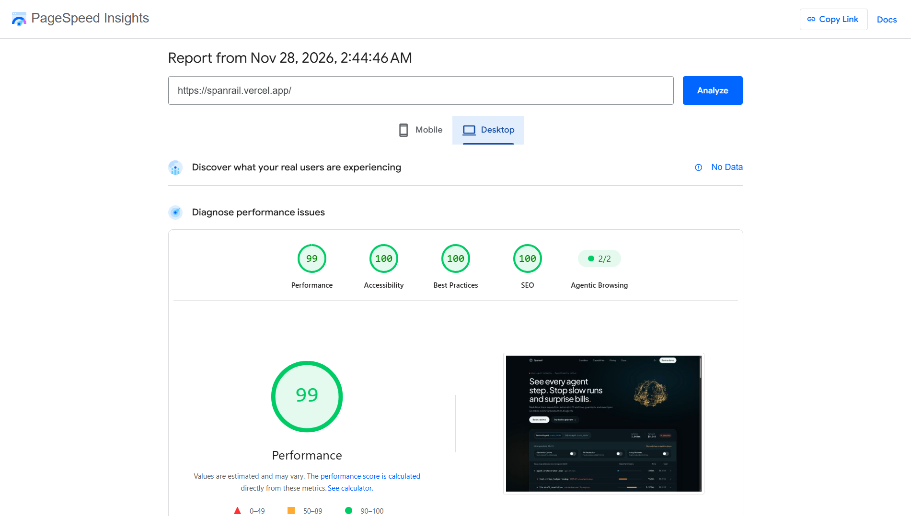
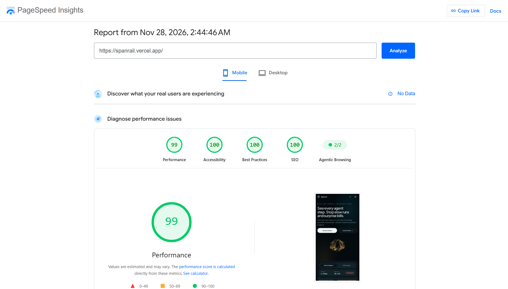
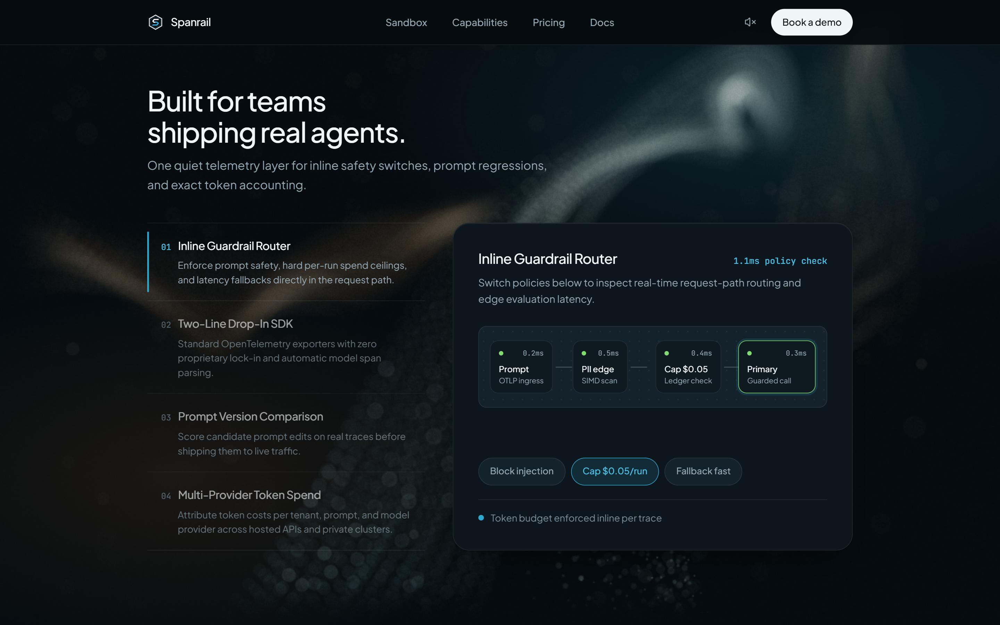
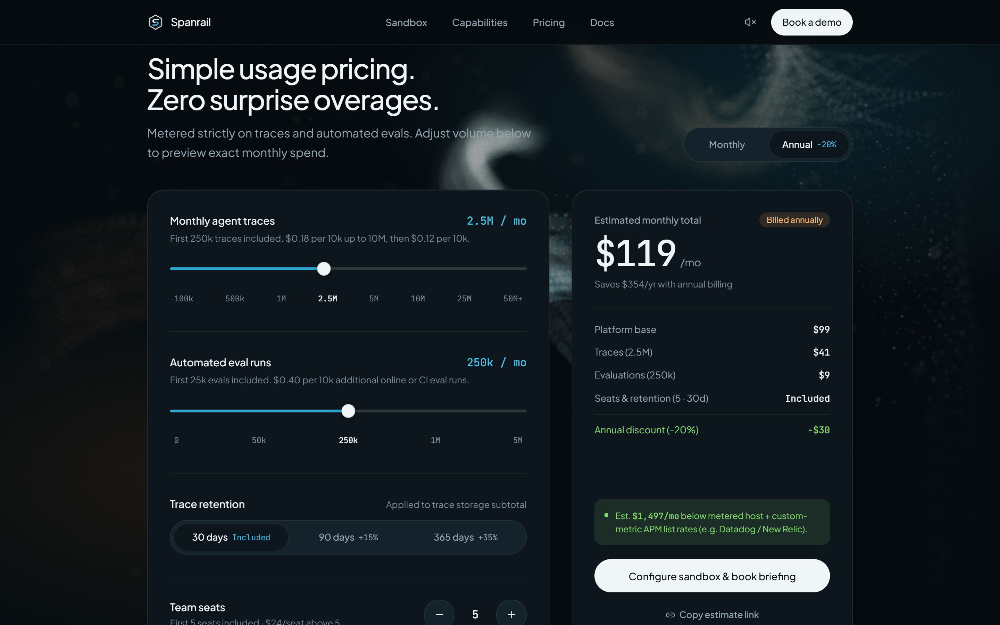
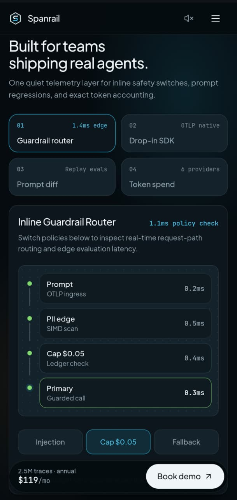
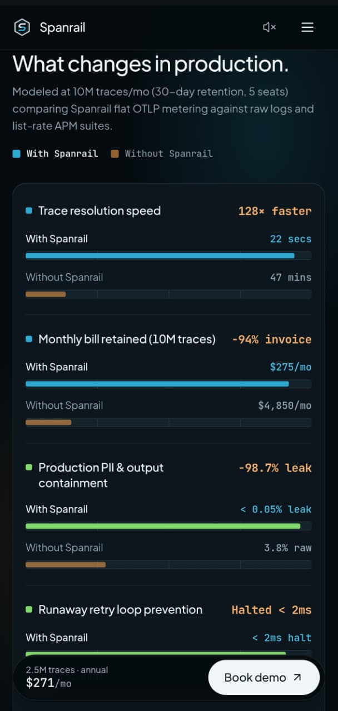
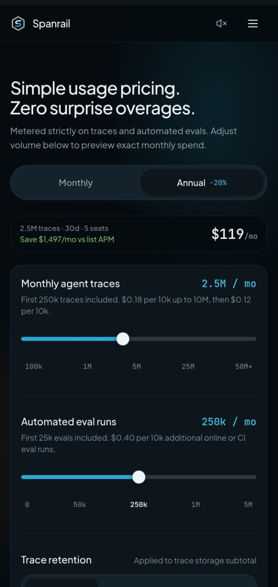
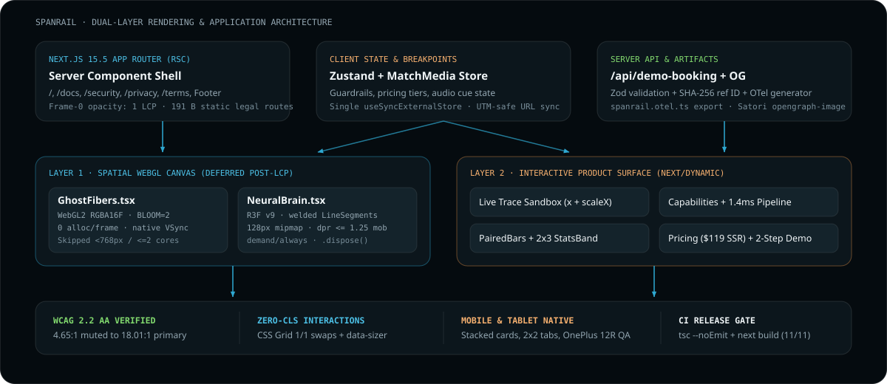

<div align="center">

# Spanrail

**Front-End Design Engineering Case Study — Interactive AI Agent Observability &amp; Inline Guardrail Platform**

*Dual-layer WebGL2 + React Three Fiber spatial stage, deterministic product-as-hero sandboxes, WCAG 2.2 AA dark design system, and dedicated Phone / Tablet / Desktop UX architectures.*

<br />

**[Live Site](https://spanrail.vercel.app/)** · **[Quickstart Docs](https://spanrail.vercel.app/docs)** · **[Security &amp; VPC](https://spanrail.vercel.app/security)** · **[Engineering Case Study](docs/CASE_STUDY.md)** · **[Portfolio](https://sparshparwaniportfolio.vercel.app/)**

<br />

[](https://github.com/Sparsh-Parwani/spanrail/actions/workflows/ci.yml)


</div>

<br />

https://github.com/user-attachments/assets/93e54801-9e41-4c02-bf9f-30ebdac053c9

<p align="center"><sub><strong>8.5s live walkthrough (1080p 60fps):</strong> Frame-0 load, toggling Semantic Cache / PII Redaction / Loop Breaker, real-time 3D <code>NeuralBrain</code> state coupling, and GPU waterfall collapse (<code>2,840ms → 780ms</code> · <code>$0.048 → $0.014</code>).</sub></p>

---

## Verified Performance, Accessibility &amp; Engineering Proof

All screenshots and metrics below are captured directly from the live production deployment ([spanrail.vercel.app](https://spanrail.vercel.app/)) — click either PageSpeed report image to inspect Google's archived audit directly.

<table>
  <tr>
    <td width="50%" align="center">
      <strong>PageSpeed Insights — Desktop</strong><br />
      <a href="https://pagespeed.web.dev/analysis/https-spanrail-vercel-app/f2yin0lnfqm8ljv08zmeg5?form_factor=desktop">
        
      </a>
      <sub><a href="https://pagespeed.web.dev/analysis/https-spanrail-vercel-app/f2yin0lnfqm8ljv08zmeg5?form_factor=desktop">Open live Desktop audit ↗</a></sub>
    </td>
    <td width="50%" align="center">
      <strong>PageSpeed Insights — Mobile</strong><br />
      <a href="https://pagespeed.web.dev/analysis/https-spanrail-vercel-app/f2yin0lnfqm8ljv08zmeg5?form_factor=mobile">
        
      </a>
      <sub><a href="https://pagespeed.web.dev/analysis/https-spanrail-vercel-app/f2yin0lnfqm8ljv08zmeg5?form_factor=mobile">Open live Mobile audit ↗</a></sub>
    </td>
  </tr>
</table>

| Engineering Pillar | Verified Result | Verifiable Proof |
|---|---|---|
| **CI &amp; Strict Type Safety** | **`11/11` routes** · **`0` TS errors** (`strict: true`) · **`0` lint warnings** | [Live GitHub Actions CI](https://github.com/Sparsh-Parwani/spanrail/actions/workflows/ci.yml) (`tsc --noEmit` + `next build`) |
| **Route JS Footprint** | **`59.5 kB`** home (`215 kB` FLJS incl. R3F/Motion) · **`1.3 kB`** `/docs` · **`191 B`** `/security`, `/privacy`, `/terms` | Server Components + `next/dynamic` splits (`src/app/page.tsx`) |
| **WCAG 2.2 AA Contrast Floor** | **`18.01:1`** primary · **`7.26:1`** secondary · **`4.65:1`–`5.29:1`** muted across all 3 dark surfaces | Mathematically verified from [`src/app/globals.css`](src/app/globals.css) |
| **WebGL2 / 3D Frame Hygiene** | **`0` per-frame heap allocs** · **max `1` WebGL context** `< 768px` (`dpr <= 1.25`) · software-WebGL safe (`failIfMajorPerformanceCaveat: true`) | [`GhostFibers.tsx`](src/components/GhostFibers.tsx) · [`NeuralBrain.tsx`](src/components/three/NeuralBrain.tsx) |
| **Zero-CLS &amp; Real-Device QA** | **`0px` button-swap shift** (`grid-area: 1 / 1`) · **`0px` horizontal overflow** (`390px`–`1920px`) | Verified on **OnePlus 12R** (`~3×` AMOLED), `820×1180` tablet, &amp; `1920×1080` Intel Iris Xe (`chrome://gpu`) |

<details>
<summary><strong>Proof 1 — Production Build Manifest (<code>Next.js 15.5.29</code>)</strong></summary>

```text
 ✓ Compiled successfully in 5.2s
 ✓ Linting and checking validity of types
 ✓ Collecting page data
 ✓ Generating static pages (11/11)

Route (app)                                 Size  First Load JS
┌ ○ /                                    59.5 kB         215 kB
├ ○ /_not-found                            997 B         104 kB
├ ƒ /api/demo-booking                      128 B         103 kB
├ ○ /docs                                 1.3 kB         157 kB
├ ○ /icon.svg                                0 B            0 B
├ ○ /opengraph-image                       128 B         103 kB
├ ○ /privacy                               191 B         146 kB
├ ○ /security                              191 B         146 kB
└ ○ /terms                                 191 B         146 kB
+ First Load JS shared by all             103 kB
```

</details>

<details>
<summary><strong>Proof 2 — Computed WCAG 2.2 Contrast Matrix (<code>src/app/globals.css</code>)</strong></summary>

| Ink Token | Hex | On Canvas (`#050b0f`) | On Surface (`#0c161c`) | On Subtle (`#14232b`) | Grade |
|---|---:|---:|---:|---:|---|
| `--ink-primary` | `#f0f5f7` | **18.01:1** | **16.66:1** | **14.64:1** | AAA |
| `--ink-secondary` | `#93a6b1` | **7.85:1** | **7.26:1** | **6.38:1** | AAA / AA+ |
| `--ink-muted` | `#788d99` | **5.72:1** | **5.29:1** | **4.65:1** | AA (`>= 4.5:1` everywhere) |

</details>

---

## Design Craft &amp; Interactive Product UX (Desktop `1440×900`)

<table>
  <tr>
    <td width="50%" align="center">
      
      <sub><strong>Editorial Hairline Index &amp; Interactive Stage</strong> — policy-wired 1.4ms router pipeline, SDK tabs, Prompt v14/v15 diff, and 6-provider spend ledger.</sub>
    </td>
    <td width="50%" align="center">
      
      <sub><strong>Reconciled Pricing &amp; Telemetry Ledger</strong> — SSR-accurate <code>$119/mo</code> default, UTM-preserving URL sync on interaction only, and reconciled <code>$275/mo</code> vs <code>$4,850/mo</code> math.</sub>
    </td>
  </tr>
</table>

- **Perceptual Dark Design System:** Built on a 3-tier token architecture (`#050b0f` deep canvas, `#0c161c` opaque occlusion-friendly surfaces, `#14232b` subtle controls, `rgba(240,245,247,0.09)` 1px hairlines, Ocean `#2ea8d1` brand, Amber `#f2994a` spark) paired with self-hosted `@fontsource-variable/plus-jakarta-sans` and `@fontsource-variable/jetbrains-mono` (`tabular-nums` across all dynamic telemetry).
- **Product-as-Hero Interaction Coupling:** Above-the-fold `HeroSection` renders at Frame-0 `opacity: 1` (zero splash gate). Toggling **Semantic Cache**, **Inline PII Redaction**, and **Loop Breaker** simultaneously updates deterministic latency (`2,840ms → 780ms`), run cost (`$0.048 → $0.014`), GPU `x` + `scaleX` waterfall bars, JSON payload redaction (`[EXPOSED]` → `[REDACTED_PII]`), Web Audio opt-in tactile cues (`M`), and the 3D `NeuralBrain` vertex/color state.
- **Compositor-Only Motion Discipline:** Powered by async `<LazyMotion features={domMax} strict>` (`m.*`). Zero `width`/`left` layout animations, zero `backdrop-filter: blur()` over animating WebGL, zero JS rAF marquees (pure CSS `translate3d(-50%, 0, 0)`), and full `prefers-reduced-motion` support (`frameloop="demand"` rather than `"never"`).

---

## Multi-Device Compatibility &amp; Dedicated Mobile-Native UX

Rather than squeezing desktop grids onto phones, every interactive surface adapts its **layout, interaction model, typographic scale, and WebGL LOD** across **Phone (`< 768px`, tested on OnePlus 12R)**, **Tablet (`768px–1023px`, tested at `820×1180`)**, and **Desktop (`>= 1024px`)**.

<table>
  <tr>
    <td width="33.3%" align="center">
      
      <br />
      <sub><strong>2×2 Selector + Vertical Pipeline</strong><br />All 4 capabilities visible (zero swipe); 4-step pipeline stacks vertically with zero label truncation.</sub>
    </td>
    <td width="33.3%" align="center">
      
      <br />
      <sub><strong>Stacked Metric Cards</strong><br />Replaces the desktop comparison ledger so every bar and observed delta reads with zero sideways table scroll.</sub>
    </td>
    <td width="33.3%" align="center">
      
      <br />
      <sub><strong>Thumb-Ergonomic Pricing</strong><br />3-col stacked-sublabel retention (<code>365 days +35%</code> fits down to <code>320px</code>) + locked <code>44px 1fr 44px</code> seat bar.</sub>
    </td>
  </tr>
</table>

### Breakpoint Compatibility Matrix

| Component / Concern | Phone (`320px–767px` · OnePlus 12R) | Tablet (`768px–1023px` · `820×1180`) | Desktop (`>= 1024px` · `1024–1920px`) |
|---|---|---|---|
| **Navigation &amp; Docks** | `56px` bar + backdrop-scrim drawer (`overscroll-contain`); `MobileBottomDock` auto-hides over `#pricing` &amp; `#demo` | Balanced `1fr_auto_1fr` nav (`px-3` links) with zero collision | Centered `1fr_auto_1fr` nav + opt-in Web Audio + `M` / `1` / `2` shortcuts |
| **WebGL &amp; 3D Budget** | Max **1 context** (`GhostFibers` skipped `< 768px`), `NeuralBrain` at `dpr <= 1.25` with `128×128` mipmap sprites &amp; `onPointerCancel` | Full dual-layer (`GhostFibers` + `NeuralBrain`, `dpr <= 1.5`) | Full dual-layer native VSync + hardware GPU guard (`failIfMajorPerformanceCaveat: true`) |
| **Capabilities &amp; Code** | 2×2 all-visible grid + vertical `<Pipeline>` + code-header **0px CLS** `Copy` (`grid-area: 1 / 1`) | 2×2 all-visible grid + horizontal `<Pipeline>` + 0px CLS `Copy` | 5/7 vertical hairline index + spacious interactive showcase stage |
| **Comparison &amp; Stats** | Vertical stacked metric cards (`PairedBars`) + compact **2×3 tap-to-toggle** `StatsBand` (`@media (hover: hover)` gated) | Full-fit horizontal `PairedBars` ledger + 2×3 `StatsBand` | Full 3-column `PairedBars` ledger + 3×2 `StatsBand` with hover/focus swap |
| **Typography &amp; Forms** | Modular mobile staircase (`13.5–14px` leads, `12.5px` cards, `11.5–12px` muted AA); `>= 16px` inputs (anti-iOS zoom), `>= 44×44px` tap targets | Mid-tier staircase (`14px` leads, `13px` cards, `12px` helpers) | Full editorial scale (`16–17px` leads, `14.5px` cards, `12.5–13px` helpers) |

---

## System &amp; Dual-Layer Rendering Architecture

<picture>
  <source media="(prefers-color-scheme: dark)" srcset="docs/assets/arch-dark.svg" />
  <source media="(prefers-color-scheme: light)" srcset="docs/assets/arch-light.svg" />
  
</picture>

- **Deep Engineering Writeup:** Read [`docs/CASE_STUDY.md`](docs/CASE_STUDY.md) for the full architectural trade-offs and real-device debugging log (144Hz native VSync fill-rate budgeting, software-WebGL protection, welded 3D synaptic vertices, CSS Grid `0px` CLS state swaps, inline-style vs. Tailwind specificity fixes, and semantic list accessibility).
- **Real Multi-Route App:** Ships live Server Component routes for [`/docs`](https://spanrail.vercel.app/docs), [`/security`](https://spanrail.vercel.app/security), [`/privacy`](https://spanrail.vercel.app/privacy), [`/terms`](https://spanrail.vercel.app/terms), dynamic Satori `/opengraph-image`, and [`POST /api/demo-booking`](src/app/api/demo-booking/route.ts) (Zod validation + SHA-256 booking reference + downloadable `spanrail.otel.ts` config).

---

## Run Locally (Zero Environment Keys Required)

```bash
git clone https://github.com/Sparsh-Parwani/spanrail.git
cd spanrail
npm ci
npm run dev
```

Run the strict verification gate locally:

```bash
npm run typecheck
npm run build
npm run start
```

> **Project Scope:** Flagship Front-End Design Engineering case study by [Sparsh Parwani](https://sparshparwaniportfolio.vercel.app/). UI telemetry traces and cost comparisons are deterministically modeled; `POST /api/demo-booking` runs live Zod validation, generates a SHA-256 booking reference, and emits downloadable OpenTelemetry (`spanrail.otel.ts`) configs ready for CRM/webhook integration.

---

<div align="center">

Designed &amp; engineered by **[Sparsh Parwani](https://sparshparwaniportfolio.vercel.app/)** · [MIT License](LICENSE)

</div>